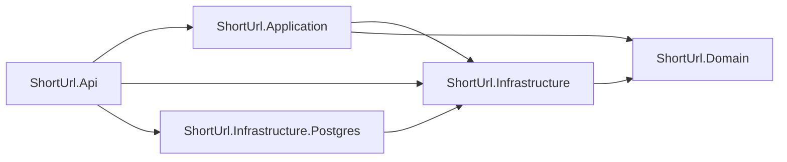

# Short URL API

**English** · [Português](README.pt-BR.md)

[](https://github.com/DaviVasconcelos/short-url-api/actions/workflows/ci.yml)


A minimal, well-architected URL shortener built with **C# and ASP.NET Core 8**. Focus on clean REST semantics, EF Core, caching and good engineering practices.

> **SDK vs runtime:** tooling uses **.NET 10 SDK + `ShortUrl.slnx`** (requires VS 2022 17.12+), but the code runs on **.NET 8 LTS** (`<TargetFramework>net8.0</TargetFramework>` in every project).

## Features

- `POST /api/auth/register` — create an account and receive a JWT (auto-login)
- `POST /api/auth/login` — authenticate and receive a JWT
- `GET /api/auth/me` — return the authenticated user (Bearer token)
- `POST /api/urls` — shorten a URL (supports custom alias + expiration)
- `GET /{code}` — 302 redirect to original URL + click tracking
- `GET /api/urls/{code}` — stats (original URL, createdAt, expiresAt, clickCount)
- `DELETE /api/urls/{code}` — delete a short URL
- Validation (http/https only, max 2048 chars), 409 on alias conflict, 410 on expired link
- In-memory cache for hot redirect path, fixed-window rate limiting on creation and auth
- JWT auth (HS256, 60 min), `PasswordHasher<User>`, normalized emails
- Swagger with Bearer auth, HealthChecks (`/health`), Docker, GitHub Actions CI, xUnit tests

## Tech stack

- **.NET 8 / ASP.NET Core** (Controllers) — `net8.0` em todos os `.csproj`
- **.NET 10 SDK + `ShortUrl.slnx`** apenas como tooling (solution formato novo)
- **EF Core + SQLite** for local dev/tests and **PostgreSQL** for production, each with its own migrations
- **JWT Bearer** (`Microsoft.AspNetCore.Authentication.JwtBearer`) + `PasswordHasher<User>`
- **IMemoryCache**, **Rate Limiting** (built-in .NET 8)
- **Swagger / Swashbuckle**, **xUnit**, **`WebApplicationFactory`** for the integration tests
- **Docker** multi-stage build

## Getting started

Prerequisites: [.NET 10 SDK](https://dotnet.microsoft.com/download) (for `slnx` tooling) + [.NET 8 runtime/SDK](https://dotnet.microsoft.com/download) (target `net8.0`), VS 2022 17.12+ or VS Code + C# Dev Kit, and optionally Docker.

```bash
git clone https://github.com/DaviVasconcelos/short-url-api
cd short-url-api
dotnet run --project src/ShortUrl.Api
```

That's it: `dotnet run` restores packages, applies EF migrations on startup, and serves the API at `http://localhost:5000` (Swagger at `/swagger`). Try it:

```bash
# 1. shorten a URL -> 201 Created + shortCode
curl -X POST http://localhost:5000/api/urls \
  -H "Content-Type: application/json" \
  -d '{"url":"https://dotnet.microsoft.com/en-us/learn","expiresInDays":30}'

# 2. follow the redirect (302) and read the stats
curl -i http://localhost:5000/<shortCode>
curl http://localhost:5000/api/urls/<shortCode>

# 3. register (returns a JWT) and call the protected endpoint
curl -X POST http://localhost:5000/api/auth/register \
  -H "Content-Type: application/json" \
  -d '{"email":"demo@example.com","password":"Password123!"}'

curl http://localhost:5000/api/auth/me \
  -H "Authorization: Bearer <token>"
```

In Development, a missing `Jwt:Key` is replaced by an ephemeral key at startup. Tokens survive only until the next restart; set `Jwt__Key` for a stable key.


With Docker (EF migrations are applied automatically on startup):

```bash
docker build -t shorturl .
docker run -p 5000:8080 \
  -e Jwt__Key="dev-only-key-at-least-32-bytes-long" shorturl

# override the public base URL used in generated short links
docker run -p 5000:8080 \
  -e Jwt__Key="dev-only-key-at-least-32-bytes-long" \
  -e ShortUrl__BaseUrl=https://your-domain shorturl
```

The container runs in `Production`, so `Jwt__Key` is required and must be at least 32 bytes. Use a real secret outside local demos. The container listens on `8080`; map it to any host port. The SQLite database lives inside the container, so mount a volume (`-v shorturl-data:/app`) to persist it.

Run tests:

```bash
dotnet test ShortUrl.slnx
```

## Testing

**46 xUnit tests** across four areas:

- `Generators/` — Base62 code length, alphabet, and argument validation.
- `Services/` — URL/alias validation, alias conflict, click increment, cache population/eviction, expiration, not-found, plus registration/login, email normalization, password hashing, JWT claims, and auth failures. They run against **SQLite in-memory** (not the EF InMemory provider, which can't execute the `ExecuteUpdateAsync` click increment).
- `Integration/` — `WebApplicationFactory<Program>` boots the real API with an in-memory SQLite database and exercises create → redirect → stats, register → `/me`, login, duplicate email, invalid credentials, and 401 responses. A dedicated test covers the auth rate limit.
- `Persistence/` — builds the PostgreSQL model without a database and asserts the generated DDL (tables, columns, unique indexes, FK); SQLite ownership covers owned vs. anonymous links.

## API reference

| Method | Route | Success | Description |
|--------|-------|---------|-------------|
| POST | `/api/auth/register` | `201 Created` | Create account and return JWT |
| POST | `/api/auth/login` | `200 OK` | Authenticate and return JWT |
| GET | `/api/auth/me` | `200 OK` | Authenticated user (Bearer token) |
| POST | `/api/urls` | `201 Created` | Shorten URL |
| GET | `/{code}` | `302 Found` | Redirect |
| GET | `/api/urls/{code}` | `200 OK` | Stats |
| DELETE | `/api/urls/{code}` | `204 No Content` | Delete |
| GET | `/health` | `200 OK` | Health check |

Example:

```http
POST /api/urls
Content-Type: application/json

{ "url": "https://dotnet.microsoft.com/en-us/learn", "customAlias": null, "expiresInDays": 30 }
```

```json
{
  "shortCode": "aB3x9Q",
  "shortUrl": "http://localhost:5000/aB3x9Q",
  "expiresAt": "2026-11-13T00:00:00Z"
}
```

Error codes: `400` invalid URL/email/password, `401` missing/invalid credentials or token, `404` not found, `409` alias or email in use, `410` expired, `429` rate limited.

Auth example:

```http
POST /api/auth/register
Content-Type: application/json

{ "email": "demo@example.com", "password": "Password123!" }
```

```json
{
  "token": "<jwt>",
  "expiresAt": "2026-10-20T21:00:00Z",
  "user": { "id": 1, "email": "demo@example.com", "createdAt": "2026-10-20T20:00:00Z" }
}
```

Register also logs the user in. Send the token as `Authorization: Bearer <jwt>` to protected endpoints such as `/api/auth/me`. Tokens last 60 minutes by default; refresh tokens are out of scope.

## Project structure

```
ShortUrl.slnx               # Solution (new XML format, SDK 10 / VS 2022 17.12+)
global.json                # Pins .NET 10 SDK for tooling; runtime stays net8.0
Dockerfile                 # Multi-stage build (sdk:8.0 -> aspnet:8.0)
.dockerignore
.github/workflows/ci.yml   # restore -> build -> test (+ docker build)
docs/images/swagger.png    # Swagger UI screenshot used in this README
src/
  ShortUrl.Domain/         # ShortUrl + User entities, ICodeGenerator port (no dependencies)
  ShortUrl.Api/            # Controllers, Program.cs, DI, JWT, rate limiter, Swagger
  ShortUrl.Application/    # DTOs, options, services (URLs + auth), JWT generation
  ShortUrl.Infrastructure/ # AppDbContext, SQLite migrations, Base62CodeGenerator adapter
  ShortUrl.Infrastructure.Postgres/ # PostgresAppDbContext + InitialPostgres migration
tests/
  ShortUrl.Tests/          # 46 xUnit tests (generators, services, integration, persistence)
```

Dependency rule: `Api -> Application -> Infrastructure`, plus `Api -> Infrastructure.Postgres -> Infrastructure`, with both `Application` and `Infrastructure` depending on `Domain`. Controllers never touch `DbContext` directly — only `IShortUrlService` or `IAuthService`.



## Technical decisions

- **302 (not 301)** for redirects so expiration and click counting keep working (browsers cache 301 aggressively).
- **Base62 7-char codes** via `RandomNumberGenerator` (~3.5T combos) + UNIQUE index + retry on collision.
- **IMemoryCache** (5 min TTL, `ShortUrl.CacheTtlSeconds`) for the redirect path. Cache-aside stores only `originalUrl` + `expiresAt` (never `clickCount`), and the click increment stays in the database via `ExecuteUpdateAsync`, so the hot `SELECT` is what gets skipped. Redis remains a stretch goal for distributed caching.
- **SQLite** (default) for zero-setup local dev and tests; **PostgreSQL** is opt-in via `Database:Provider=Postgres`. Each provider has its own migrations, so the same model is validated against both.
- **Provider-agnostic service**: `ShortUrlService` depends only on `AppDbContext`; `AddDbContext<AppDbContext, PostgresAppDbContext>` swaps the implementation.
- **JWT auth** with HS256, 60-minute expiry, `sub`/`email`/`jti` claims. `AuthService` validates e-mails, normalizes them to lowercase, hashes passwords with ASP.NET Core Identity's `PasswordHasher<User>`, and issues tokens after register/login. There are no refresh tokens, roles, or password reset flows.
- **Fixed-window rate limiting**: 30 req/min/IP on URL creation and 10 req/min/IP on register/login, returning `429` with `Retry-After`.
- **Reserved aliases** (`api`, `urls`, `health`, `swagger`, `favicon.ico`) are rejected to avoid shadowing app routes.
- **`/health`** checks the configured DbContext (`AddDbContextCheck`) so orchestrators can probe readiness.
- **Migrations run on startup** (with retry), so `docker run` and future deploys need no manual `dotnet ef database update`.

### Cache in practice

With EF command logging enabled (`Microsoft.EntityFrameworkCore.Database.Command: Information` in `appsettings.Development.json`), two consecutive `GET /{code}` requests produced:

- **Without cache** (baseline): 2 `SELECT` + 2 `UPDATE`.
- **With cache**: 1 `SELECT` + 2 `UPDATE` — the second redirect is served from memory; only the click counter still touches the database.

Behavior is unchanged: both requests return `302` and the stats endpoint reports `clickCount = 2`.

## Configuration

`appsettings.json`:

```json
{
  "Database": { "Provider": "Sqlite" },
  "ConnectionStrings": {
    "Default": "Data Source=shorturl.db",
    "Postgres": ""
  },
  "ShortUrl": { "BaseUrl": "http://localhost:5000", "CodeLength": 7, "DefaultExpiryDays": 30, "CacheTtlSeconds": 300 },
  "Jwt": { "Issuer": "ShortUrl.Api", "Audience": "ShortUrl.Api", "ExpiryMinutes": 60 }
}
```

`Jwt:Key` is intentionally absent from configuration. In Development, the API generates an ephemeral 32-byte key when it is missing (tokens are invalidated on restart). Outside Development, startup fails fast unless `Jwt__Key` is set to a secret of at least 32 bytes. The Docker image runs in `Production`, so pass `-e Jwt__Key=...` when running it.

SQLite is the default. To run against PostgreSQL locally:

```bash
docker run --rm -d --name shorturl-pg \
  -e POSTGRES_PASSWORD=postgres -e POSTGRES_DB=shorturl \
  -p 5432:5432 postgres:16-alpine

export Database__Provider=Postgres
export ConnectionStrings__Postgres="Host=localhost;Port=5432;Database=shorturl;Username=postgres;Password=postgres"
dotnet run --project src/ShortUrl.Api
```

Migrations are applied on startup. Each provider keeps its own history (`InitialCreate` for SQLite, `InitialPostgres` for PostgreSQL); never point one provider at the other's migrations. In production, set `Database__Provider=Postgres` and `ConnectionStrings__Postgres` as environment variables/secrets.

## Roadmap

See `PLAN.md` §12 for the detailed phase breakdown.

**Active scope**
- [x] PostgreSQL provider + migrations (production)
- [x] JWT auth (`register`, `login`, `me`) with Swagger Bearer support
- [ ] Per-user ownership + protected delete
- [ ] Paginated listing of the authenticated user's links
- [ ] Public demo deploy (Render Free + Neon)
- [ ] Docs, tests, and deploy runbook

**Stretch**
- [ ] Redis distributed cache
- [ ] BackgroundService to purge expired links
- [ ] Per-user rate limiting

**Cut**
- SQL Server local sample (redundant with PostgreSQL)

## License

MIT — see [LICENSE](LICENSE). Feel free to use as a template.
