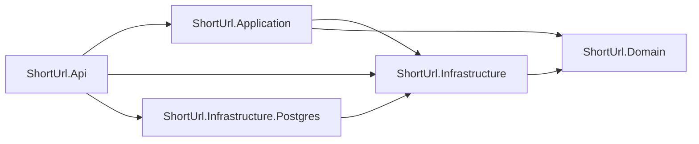

# Short URL API

**English** · [Português](README.pt-BR.md)

[](https://github.com/DaviVasconcelos/short-url-api/actions/workflows/ci.yml)


A minimal, well-architected URL shortener built with **C# and ASP.NET Core 8**. Focus on clean REST semantics, EF Core, caching and good engineering practices.

> **Live demo:** <https://shorturl-davi.onrender.com> · [Swagger](https://shorturl-davi.onrender.com/swagger). It runs on free tiers, so the first request after ~15 minutes of inactivity can take up to a minute while Render and Neon wake up.

> **SDK vs runtime:** tooling uses **.NET 10 SDK + `ShortUrl.slnx`** (requires VS 2022 17.12+), but the code runs on **.NET 8 LTS** (`<TargetFramework>net8.0</TargetFramework>` in every project).

## Features

- `POST /api/auth/register` — create an account and receive a JWT (auto-login)
- `POST /api/auth/login` — authenticate and receive a JWT
- `GET /api/auth/me` — return the authenticated user (Bearer token)
- `POST /api/urls` — shorten a URL (supports custom alias + expiration; optional Bearer token sets the owner)
- `GET /api/urls` — paginated list of the authenticated user's links
- `GET /{code}` — 302 redirect to original URL + click tracking
- `GET /api/urls/{code}` — stats (original URL, createdAt, expiresAt, clickCount)
- `DELETE /api/urls/{code}` — delete an owned short URL (Bearer token required)
- Validation (http/https only, max 2048 chars, `expiresInDays` up to 3650), 409 on alias conflict, 410 on expired link
- In-memory cache for hot redirect path, fixed-window rate limiting per user (per IP when anonymous) on create, list, delete and auth
- Background cleanup that purges links 30 days after they expire (`Cleanup:*`, off by default)
- JWT auth (HS256, 60 min), `PasswordHasher<User>`, normalized emails
- Ownership: authenticated creates are owned; only the owner can list or delete them, and anonymous links cannot be deleted via the API
- Swagger with Bearer auth, HealthChecks (`/health/live` for liveness, `/health` for readiness), Docker, GitHub Actions CI, xUnit tests

## Tech stack

- **.NET 8 / ASP.NET Core** (Controllers) — `net8.0` em todos os `.csproj`
- **.NET 10 SDK + `ShortUrl.slnx`** apenas como tooling (solution formato novo)
- **EF Core + SQLite** for local dev/tests and **PostgreSQL** for production, each with its own migrations
- **JWT Bearer** (`Microsoft.AspNetCore.Authentication.JwtBearer`) + `PasswordHasher<User>`
- **IMemoryCache**, **Rate Limiting** (built-in .NET 8), **`BackgroundService` + `TimeProvider`** for the cleanup job
- **Swagger / Swashbuckle**, **xUnit**, **`WebApplicationFactory`** for the integration tests
- **Docker** multi-stage build

## Getting started

Prerequisites: [.NET 10 SDK](https://dotnet.microsoft.com/download) (for `slnx` tooling) + [.NET 8 runtime/SDK](https://dotnet.microsoft.com/download) (target `net8.0`), VS 2022 17.12+ or VS Code + C# Dev Kit, and optionally Docker.

```bash
git clone https://github.com/DaviVasconcelos/short-url-api
cd short-url-api
dotnet run --project src/ShortUrl.Api
```

That's it: `dotnet run` restores packages, applies EF migrations on startup, and serves the API at `http://localhost:5000` (Swagger at `/swagger`). Try it:

```bash
# 1. shorten a URL -> 201 Created + shortCode
curl -X POST http://localhost:5000/api/urls \
  -H "Content-Type: application/json" \
  -d '{"url":"https://dotnet.microsoft.com/en-us/learn","expiresInDays":30}'

# 2. follow the redirect (302) and read the stats
curl -i http://localhost:5000/<shortCode>
curl http://localhost:5000/api/urls/<shortCode>

# 3. register (returns a JWT) and call the protected endpoint
curl -X POST http://localhost:5000/api/auth/register \
  -H "Content-Type: application/json" \
  -d '{"email":"demo@example.com","password":"Password123!"}'

curl http://localhost:5000/api/auth/me \
  -H "Authorization: Bearer <token>"

# 4. create an owned link and delete it (the token must belong to the owner)
curl -X POST http://localhost:5000/api/urls \
  -H "Content-Type: application/json" \
  -H "Authorization: Bearer <token>" \
  -d '{"url":"https://example.com/owned","expiresInDays":30}'

curl -X DELETE http://localhost:5000/api/urls/<shortCode> \
  -H "Authorization: Bearer <token>"
```

In Development, a missing `Jwt:Key` is replaced by an ephemeral key at startup. Tokens survive only until the next restart; set `Jwt__Key` for a stable key.


With Docker (EF migrations are applied automatically on startup):

```bash
docker build -t shorturl .
docker run -p 5000:8080 \
  -e Jwt__Key="dev-only-key-at-least-32-bytes-long" shorturl

# Render-style: listen on $PORT and expose Swagger in Production
docker run -p 10000:10000 \
  -e PORT=10000 \
  -e Jwt__Key="dev-only-key-at-least-32-bytes-long" \
  -e Swagger__Enabled=true shorturl

# override the public base URL used in generated short links
docker run -p 5000:8080 \
  -e Jwt__Key="dev-only-key-at-least-32-bytes-long" \
  -e ShortUrl__BaseUrl=https://your-domain shorturl
```

The container runs in `Production`, so `Jwt__Key` is required and must be at least 32 bytes. Use a real secret outside local demos. It listens on `8080` by default; when `PORT` is set (as on Render), it listens on that port. The SQLite database lives inside the container, so mount a volume (`-v shorturl-data:/app`) to persist it. Swagger is disabled in Production unless `Swagger__Enabled=true`. When `ShortUrl__BaseUrl` is unset, generated links use the request scheme and host (honoring `X-Forwarded-Proto`), so a deploy works without extra configuration.

## Deploy

The public demo is live at <https://shorturl-davi.onrender.com>, running on **Render Free** (Docker) with **Neon Free** PostgreSQL. The service is declared in [`render.yaml`](render.yaml) and the step-by-step runbook — Neon project, Render secrets, smoke test, cold-start behavior and rollback — is in [`docs/deploy.md`](docs/deploy.md).

Production configuration lives only in environment variables (`Database__Provider`, `ConnectionStrings__Postgres`, `Jwt__Key`, `Swagger__Enabled`, `Cleanup__Enabled`); no secret is committed. Migrations apply on startup, so the first deploy needs no manual `dotnet ef database update`.

## Testing

Run the suite:

```bash
dotnet test ShortUrl.slnx
```

**107 xUnit tests** across four areas:

- `Generators/` — Base62 code length, alphabet, and argument validation.
- `Services/` — URL/alias validation, alias conflict, click increment, cache population/eviction, expiration (including the 3650-day cap and "never expires" for `<= 0`), not-found, owner assignment, delete ownership, paginated owner listing, configurable/request base URL, expired-link cleanup (retention window, links without expiry, multiple batches, idempotency, driven by a fake `TimeProvider`), plus registration/login, email normalization, password hashing, JWT claims, and auth failures. They run against **SQLite in-memory** (not the EF InMemory provider, which can't execute the `ExecuteUpdateAsync` click increment).
- `Integration/` — `WebApplicationFactory<Program>` boots the real API with an in-memory SQLite database and exercises create → redirect → stats, register → `/me`, login, duplicate email, invalid credentials, 401 responses, ownership `401`/`403`/`404` flows, authenticated pagination, liveness/readiness probes, the Swagger flag, `ForwardedHeaders`, the request-derived base URL, the configurable migration retry policy, and the root landing. Dedicated tests cover the auth rate limit and the per-user rate-limit partitions (a caller exhausting their bucket does not affect another user, and anonymous callers fall back to the IP bucket). Four `PostgresApiTests` boot the API against a real PostgreSQL instead: they apply the PostgreSQL migrations on startup and exercise health, create → redirect → click, owned list/delete, and stats. They only run when `SHORTURL_TEST_POSTGRES` points at a database (the CI `postgres` job sets it) and are skipped otherwise.
- `Persistence/` — builds the PostgreSQL model without a database and asserts the generated DDL (tables, columns, unique indexes, FK); SQLite ownership covers owned vs. anonymous links.

## API reference

| Method | Route | Success | Description |
|--------|-------|---------|-------------|
| POST | `/api/auth/register` | `201 Created` | Create account and return JWT |
| POST | `/api/auth/login` | `200 OK` | Authenticate and return JWT |
| GET | `/api/auth/me` | `200 OK` | Authenticated user (Bearer token) |
| POST | `/api/urls` | `201 Created` | Shorten URL (optional Bearer token sets owner) |
| GET | `/api/urls` | `200 OK` | Paginated list of the authenticated user's links |
| GET | `/{code}` | `302 Found` | Redirect |
| GET | `/api/urls/{code}` | `200 OK` | Stats |
| DELETE | `/api/urls/{code}` | `204 No Content` | Delete an owned URL (Bearer token required) |
| GET | `/health/live` | `200 OK` | Liveness probe (no dependencies) |
| GET | `/health` | `200 OK` | Readiness probe (checks the database) |
| GET | `/` | `302 Found` | Redirects to Swagger; returns a JSON index when Swagger is disabled |

`POST /api/urls` accepts an optional Bearer token; when present, the link is owned by that user. `expiresInDays` is optional (defaults to `ShortUrl:DefaultExpiryDays`, 30), must be at most `3650`, and `0` or a negative value means the link never expires. `GET /api/urls` requires a Bearer token and returns only the caller's links; `page` defaults to `1`, `pageSize` to `20` (maximum `100`), and expired links remain listed until deleted. `DELETE` requires a Bearer token: `401` without/invalid, `403` for a non-owner or anonymous link, `404` if the code is missing. Stats and redirects stay public.

Example:

```http
POST /api/urls
Content-Type: application/json

{ "url": "https://dotnet.microsoft.com/en-us/learn", "customAlias": null, "expiresInDays": 30 }
```

```json
{
  "shortCode": "aB3x9Q",
  "shortUrl": "http://localhost:5000/aB3x9Q",
  "expiresAt": "2026-11-13T00:00:00Z"
}
```

List your links:

```http
GET /api/urls?page=1&pageSize=20
Authorization: Bearer <jwt>
```

```json
{
  "items": [
    {
      "shortCode": "aB3x9Q",
      "shortUrl": "http://localhost:5000/aB3x9Q",
      "originalUrl": "https://dotnet.microsoft.com/en-us/learn",
      "createdAt": "2026-10-26T12:00:00Z",
      "expiresAt": "2026-11-25T12:00:00Z",
      "clickCount": 12
    }
  ],
  "page": 1,
  "pageSize": 20,
  "totalCount": 1,
  "totalPages": 1
}
```

Error codes: `400` invalid URL/email/password, out-of-range `expiresInDays` or pagination, `401` missing/invalid credentials or token, `403` non-owner or anonymous link on delete, `404` not found, `409` alias or email in use, `410` expired, `429` rate limited. An expired link answers `410` for 30 days and `404` after the cleanup removes the row (ADR-0009).

Auth example:

```http
POST /api/auth/register
Content-Type: application/json

{ "email": "demo@example.com", "password": "Password123!" }
```

```json
{
  "token": "<jwt>",
  "expiresAt": "2026-10-20T21:00:00Z",
  "user": { "id": 1, "email": "demo@example.com", "createdAt": "2026-10-20T20:00:00Z" }
}
```

Register also logs the user in. Send the token as `Authorization: Bearer <jwt>` to protected endpoints such as `/api/auth/me`, and to `POST`/`GET`/`DELETE /api/urls`. Creating with a token assigns the link to that user; only the owner can list or delete it. Tokens last 60 minutes by default; refresh tokens are out of scope.

## Project structure

```
ShortUrl.slnx               # Solution (new XML format, SDK 10 / VS 2022 17.12+)
global.json                # Pins .NET 10 SDK for tooling; runtime stays net8.0
Dockerfile                 # Multi-stage build (sdk:8.0 -> aspnet:8.0)
.dockerignore
render.yaml                # Render Blueprint for the public demo (Docker + Neon)
.github/workflows/ci.yml   # restore -> build -> test, PostgreSQL job, docker build
.config/dotnet-tools.json  # dotnet-ef pinned, restored with `dotnet tool restore`
GLOSSARY.md                # Domain vocabulary (single source of truth)
docs/adr/                  # Architecture Decision Records (0001-0010)
docs/deploy.md             # Deploy runbook (Neon, Render, smoke test, free-tier behavior)
docs/images/swagger.png    # Swagger UI screenshot used in this README
src/
  ShortUrl.Domain/         # ShortUrl + User entities, ICodeGenerator port (no dependencies)
  ShortUrl.Api/            # Controllers, Program.cs, DI, JWT, rate limiter, Swagger, cleanup job
  ShortUrl.Application/    # DTOs, options, services (URLs + auth + expired-link cleaner), JWT generation
  ShortUrl.Infrastructure/ # AppDbContext, SQLite migrations, Base62CodeGenerator adapter
  ShortUrl.Infrastructure.Postgres/ # PostgresAppDbContext + InitialPostgres migration
tests/
  ShortUrl.Tests/          # 107 xUnit tests (generators, services, integration, persistence)
```

Dependency rule: `Api -> Application -> Infrastructure`, plus `Api -> Infrastructure.Postgres -> Infrastructure`, with both `Application` and `Infrastructure` depending on `Domain`. Controllers never touch `DbContext` directly — only `IShortUrlService` or `IAuthService`.



## Technical decisions

Each bullet below is recorded as an ADR in [`docs/adr/`](docs/adr/) (context, decision, consequences); the project vocabulary lives in [`GLOSSARY.md`](GLOSSARY.md).

- **302 (not 301)** for redirects so expiration and click counting keep working (browsers cache 301 aggressively).
- **Base62 7-char codes** via `RandomNumberGenerator` (~3.5T combos) + UNIQUE index + retry on collision.
- **IMemoryCache** (5 min TTL, `ShortUrl.CacheTtlSeconds`) for the redirect path. Cache-aside stores only `originalUrl` + `expiresAt` (never `clickCount`), and the click increment stays in the database via `ExecuteUpdateAsync`, so the hot `SELECT` is what gets skipped. Redis remains a stretch goal for distributed caching.
- **SQLite** (default) for zero-setup local dev and tests; **PostgreSQL** is opt-in via `Database:Provider=Postgres`. Each provider has its own migrations, so the same model is validated against both.
- **Provider-agnostic service**: `ShortUrlService` depends only on `AppDbContext`; `AddDbContext<AppDbContext, PostgresAppDbContext>` swaps the implementation.
- **JWT auth** with HS256, 60-minute expiry, `sub`/`email`/`jti` claims. `AuthService` validates e-mails, normalizes them to lowercase, hashes passwords with ASP.NET Core Identity's `PasswordHasher<User>`, and issues tokens after register/login. There are no refresh tokens, roles, or password reset flows.
- **Ownership** is optional on create and mandatory on delete. A valid Bearer token sets `ShortUrl.OwnerId`; anonymous creation remains supported. `DELETE` is owner-only, returns `403` for non-owners and anonymous links, and `401` without a valid token. Stats and redirects remain public.
- **Fixed-window rate limiting, partitioned by user**: `create-url` (30/min), `list-urls` (60/min) and `delete-url` (30/min) key on `user:{id}` when the request carries a valid token and on `ip:{ip}` otherwise; `auth` (10/min) always keys on the IP, because there is no identity before login. Responses are `429` with `Retry-After`. `UseRateLimiter()` runs *after* `UseAuthentication()`, otherwise `HttpContext.User` is empty and the user bucket would silently degrade to IP ([ADR-0010](docs/adr/0010-rate-limits-partitioned-by-user.md)).
- **`expiresInDays` is capped at 3650 days** (ten years). Above that the service answers `400` instead of letting `DateTime.AddDays` overflow into a `500`; `<= 0` keeps meaning "never expires".
- **Reserved aliases** (`api`, `urls`, `health`, `swagger`, `favicon.ico`) are rejected to avoid shadowing app routes.
- **Liveness and readiness are separate**: `/health/live` only proves the process is up, while `/health` runs the DbContext check. Orchestrators should point liveness probes at `/health/live` so a waking database does not trigger restarts.
- **Forwarded headers** (`X-Forwarded-For` and `X-Forwarded-Proto`) are trusted from any proxy, because Render's proxy pool is dynamic. `ForwardLimit` stays at `1`, so only the rightmost address is consumed and rate limiting sees the client IP.
- **Base URL** comes from `ShortUrl:BaseUrl` when configured; otherwise it is derived from the request (`scheme://host`), which keeps links correct on localhost and on the public demo. `Swagger:Enabled` defaults to the environment (on in Development, off in Production).
- **Migrations run on startup** (with retry), so `docker run` and future deploys need no manual `dotnet ef database update`.
- **Expired links are purged 30 days after expiry**, in batches, by an in-process `BackgroundService` that is off unless `Cleanup:Enabled` is set. The retention window keeps `410 Gone` meaningful for a month; after the row is deleted the same code answers `404`.

### Cache in practice

With EF command logging enabled (`Microsoft.EntityFrameworkCore.Database.Command: Information` in `appsettings.Development.json`), two consecutive `GET /{code}` requests produced:

- **Without cache** (baseline): 2 `SELECT` + 2 `UPDATE`.
- **With cache**: 1 `SELECT` + 2 `UPDATE` — the second redirect is served from memory; only the click counter still touches the database.

Behavior is unchanged: both requests return `302` and the stats endpoint reports `clickCount = 2`.

## Configuration

`appsettings.json`:

```json
{
  "Database": { "Provider": "Sqlite" },
  "ConnectionStrings": {
    "Default": "Data Source=shorturl.db",
    "Postgres": ""
  },
  "ShortUrl": { "CodeLength": 7, "DefaultExpiryDays": 30, "CacheTtlSeconds": 300 },
  "Jwt": { "Issuer": "ShortUrl.Api", "Audience": "ShortUrl.Api", "ExpiryMinutes": 60 },
  "Cleanup": { "Enabled": false, "IntervalMinutes": 60, "RetentionDays": 30, "BatchSize": 500 },
  "RateLimiting": { "CreatePerMinute": 30, "ListPerMinute": 60, "DeletePerMinute": 30, "AuthPerMinute": 10 }
}
```

`Jwt:Key` is intentionally absent from configuration. In Development, the API generates an ephemeral 32-byte key when it is missing (tokens are invalidated on restart). Outside Development, startup fails fast unless `Jwt__Key` is set to a secret of at least 32 bytes. The Docker image runs in `Production`, so pass `-e Jwt__Key=...` when running it.

`ShortUrl:BaseUrl` is optional: leave it unset to derive links from the incoming request, or set `ShortUrl__BaseUrl` to pin a public domain. Swagger follows `Swagger:Enabled` and defaults to on in Development / off in Production; set `Swagger__Enabled=true` to expose it in a container or deploy.

`Cleanup:Enabled` turns the expired-link cleanup on (default off, so local runs never delete data). When enabled, a `BackgroundService` runs once at startup and then every `Cleanup:IntervalMinutes`, deleting links whose `ExpiresAt` is older than `Cleanup:RetentionDays` (30) in batches of `Cleanup:BatchSize` (500). The retention window is why an expired link answers `410 Gone` for a month before the row disappears and the same code starts answering `404` — see [ADR-0009](docs/adr/0009-expired-link-retention.md).

`RateLimiting:*` sets the per-minute quotas for each policy (`create-url`, `list-urls`, `delete-url`, `auth`). Every value is validated at startup (1–10000), so a typo fails the boot instead of silently disabling the limit. Limits live in the process, so a multi-instance deployment would allow the full quota per instance — a distributed limiter needs Redis and is out of scope.

SQLite is the default. To run against PostgreSQL locally:

```bash
docker run --rm -d --name shorturl-pg \
  -e POSTGRES_PASSWORD=postgres -e POSTGRES_DB=shorturl \
  -p 5432:5432 postgres:16-alpine

export Database__Provider=Postgres
export ConnectionStrings__Postgres="Host=localhost;Port=5432;Database=shorturl;Username=postgres;Password=postgres"
dotnet run --project src/ShortUrl.Api
```

Migrations are applied on startup. Each provider keeps its own history (`InitialCreate` for SQLite, `InitialPostgres` for PostgreSQL); never point one provider at the other's migrations. In production, set `Database__Provider=Postgres` and `ConnectionStrings__Postgres` as environment variables/secrets.

## Roadmap

See `PLAN.md` §12 for the detailed phase breakdown.

**Active scope**
- [x] PostgreSQL provider + migrations (production)
- [x] JWT auth (`register`, `login`, `me`) with Swagger Bearer support
- [x] Per-user ownership + protected delete
- [x] Paginated listing of the authenticated user's links
- [x] Container readiness (`$PORT`, liveness/readiness probes, forwarded headers, Swagger flag, base URL fallback)
- [x] Public demo deploy (Render Free + Neon)
- [x] Docs, tests, and deploy runbook
- [x] Background cleanup of expired links (30-day retention, batched, configurable)
- [x] Rate limits partitioned by user, with listing/delete policies and a validated `expiresInDays` cap

**Stretch**
- [ ] Redis distributed cache

**Cut**
- SQL Server local sample (redundant with PostgreSQL)

## License

MIT — see [LICENSE](LICENSE). Feel free to use as a template.
