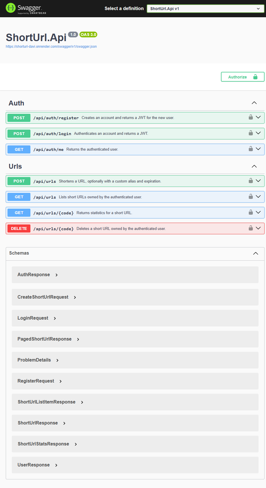
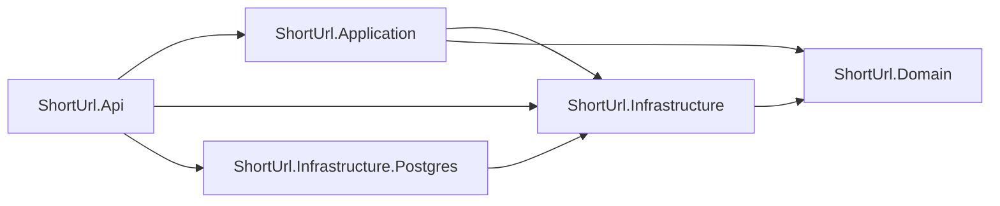

# Short URL API

[English](README.md) · **Português**

[](https://github.com/DaviVasconcelos/short-url-api/actions/workflows/ci.yml)


Um encurtador de URLs minimalista e bem arquitetado, feito com **C# e ASP.NET Core 8**. Foco em REST bem feito, EF Core, cache e boas práticas de engenharia.

> **Demo pública:** <https://shorturl-davi.onrender.com> · [Swagger](https://shorturl-davi.onrender.com/swagger). Roda em free tier, então a primeira requisição depois de ~15 minutos ocioso pode levar até um minuto enquanto Render e Neon acordam.

> **SDK vs runtime:** o tooling usa **.NET 10 SDK + `ShortUrl.slnx`** (requer VS 2022 17.12+), mas o código roda em **.NET 8 LTS** (`<TargetFramework>net8.0</TargetFramework>` em todos os projetos).

## Funcionalidades

- `POST /api/auth/register` — cria uma conta e devolve um JWT (auto-login)
- `POST /api/auth/login` — autentica e devolve um JWT
- `GET /api/auth/me` — retorna o usuário autenticado (Bearer token)
- `POST /api/urls` — encurta uma URL (suporta alias customizado + expiração; Bearer token opcional define o dono)
- `GET /api/urls` — lista paginada dos links do usuário autenticado
- `GET /{code}` — redirect 302 para a URL original + contagem de cliques
- `GET /api/urls/{code}` — estatísticas (URL original, createdAt, expiresAt, clickCount)
- `DELETE /api/urls/{code}` — remove uma URL curta com dono (Bearer token obrigatório)
- Validação (apenas http/https, máx. 2048 chars, `expiresInDays` até 3650), 409 em conflito de alias, 410 em link expirado
- Cache em memória no caminho quente de redirect, rate limiting de janela fixa por usuário (por IP quando anônimo) na criação, listagem, delete e auth
- Cleanup em background que apaga links 30 dias após expirarem (`Cleanup:*`, desligado por padrão)
- Auth JWT (HS256, 60 min), `PasswordHasher<User>`, emails normalizados
- Ownership: creates autenticados ganham dono; só o dono lista ou deleta, e links anônimos não podem ser deletados pela API
- Swagger com Bearer auth, HealthChecks (`/health/live` para liveness, `/health` para readiness), Docker, CI no GitHub Actions, testes xUnit

## Stack

- **.NET 8 / ASP.NET Core** (Controllers) — `net8.0` em todos os `.csproj`
- **.NET 10 SDK + `ShortUrl.slnx`** apenas como tooling (solution no formato novo)
- **EF Core + SQLite** para dev local/testes e **PostgreSQL** para produção, cada um com suas próprias migrations
- **JWT Bearer** (`Microsoft.AspNetCore.Authentication.JwtBearer`) + `PasswordHasher<User>`
- **IMemoryCache**, **Rate Limiting** (nativo do .NET 8), **`BackgroundService` + `TimeProvider`** para o job de cleanup
- **Swagger / Swashbuckle**, **xUnit**, **`WebApplicationFactory`** para os testes de integração
- **Docker** com build multi-stage

## Começando

Pré-requisitos: [.NET 10 SDK](https://dotnet.microsoft.com/download) (para o tooling do `slnx`) + [.NET 8 runtime/SDK](https://dotnet.microsoft.com/download) (target `net8.0`), VS 2022 17.12+ ou VS Code + C# Dev Kit, e opcionalmente Docker.

```bash
git clone https://github.com/DaviVasconcelos/short-url-api
cd short-url-api
dotnet run --project src/ShortUrl.Api
```

É isso: `dotnet run` restaura os pacotes, aplica as migrations do EF no startup e sobe a API em `http://localhost:5000` (Swagger em `/swagger`). Teste:

```bash
# 1. encurta uma URL -> 201 Created + shortCode
curl -X POST http://localhost:5000/api/urls \
  -H "Content-Type: application/json" \
  -d '{"url":"https://dotnet.microsoft.com/en-us/learn","expiresInDays":30}'

# 2. segue o redirect (302) e lê as estatísticas
curl -i http://localhost:5000/<shortCode>
curl http://localhost:5000/api/urls/<shortCode>

# 3. registra (devolve um JWT) e chama o endpoint protegido
curl -X POST http://localhost:5000/api/auth/register \
  -H "Content-Type: application/json" \
  -d '{"email":"demo@example.com","password":"Password123!"}'

curl http://localhost:5000/api/auth/me \
  -H "Authorization: Bearer <token>"

# 4. cria um link com dono e o remove (o token precisa ser do dono)
curl -X POST http://localhost:5000/api/urls \
  -H "Content-Type: application/json" \
  -H "Authorization: Bearer <token>" \
  -d '{"url":"https://example.com/owned","expiresInDays":30}'

curl -X DELETE http://localhost:5000/api/urls/<shortCode> \
  -H "Authorization: Bearer <token>"
```

Em Development, um `Jwt:Key` ausente é substituído por uma chave efêmera no startup. Os tokens só valem até o próximo restart; defina `Jwt__Key` para uma chave estável.

Prefere clicar a digitar? [`src/ShortUrl.Api/ShortUrl.Api.http`](src/ShortUrl.Api/ShortUrl.Api.http) tem todas as requisições acima e também os caminhos de erro (`400`/`401`/`403`/`404`/`409`/`429`) prontos para rodar no REST Client do VS Code ou no runner `.http` do Rider/Visual Studio.



Com Docker (as migrations do EF são aplicadas automaticamente no startup):

```bash
docker build -t shorturl .
docker run -p 5000:8080 \
  -e Jwt__Key="dev-only-key-at-least-32-bytes-long" shorturl

# estilo Render: escuta em $PORT e expõe o Swagger em Production
docker run -p 10000:10000 \
  -e PORT=10000 \
  -e Jwt__Key="dev-only-key-at-least-32-bytes-long" \
  -e Swagger__Enabled=true shorturl

# sobrescreve a URL base usada nos links curtos gerados
docker run -p 5000:8080 \
  -e Jwt__Key="dev-only-key-at-least-32-bytes-long" \
  -e ShortUrl__BaseUrl=https://your-domain shorturl
```

O container roda em `Production`, então `Jwt__Key` é obrigatória e precisa ter pelo menos 32 bytes. Use um secret real fora de demos locais. Ele escuta em `8080` por padrão; quando `PORT` está definida (como no Render), escuta nessa porta. O banco SQLite fica dentro do container, então monte um volume (`-v shorturl-data:/app`) para persistir. O Swagger fica desabilitado em Production a menos que `Swagger__Enabled=true`. Quando `ShortUrl__BaseUrl` não está definida, os links gerados usam o scheme e o host da requisição (respeitando `X-Forwarded-Proto`), então o deploy funciona sem configuração extra.

## Deploy

A demo pública está no ar em <https://shorturl-davi.onrender.com>, rodando em **Render Free** (Docker) com **Neon Free** (PostgreSQL). O serviço está declarado em [`render.yaml`](render.yaml) e o passo a passo — projeto no Neon, secrets no Render, smoke test, cold start e rollback — está em [`docs/deploy.md`](docs/deploy.md) (em inglês).

A configuração de produção vive apenas em variáveis de ambiente (`Database__Provider`, `ConnectionStrings__Postgres`, `Jwt__Key`, `Swagger__Enabled`, `Cleanup__Enabled`); nenhum secret é versionado. As migrations são aplicadas no startup, então o primeiro deploy não precisa de `dotnet ef database update` manual.

## Testes

Rodar a suíte:

```bash
dotnet test ShortUrl.slnx
```

**107 testes xUnit** em quatro áreas:

- `Generators/` — tamanho e alfabeto do código Base62 e validação de argumento.
- `Services/` — validação de URL/alias, conflito de alias, incremento de clique, populate/evict do cache, expiração (incluindo o teto de 3650 dias e o "nunca expira" para `<= 0`), not found, atribuição de dono, ownership no delete, listagem paginada por dono, base URL configurada/da requisição, cleanup de links expirados (janela de retenção, links sem expiração, múltiplos lotes, idempotência, com um `TimeProvider` falso), além de register/login, normalização de email, hash de senha, claims do JWT e falhas de auth. Rodam contra **SQLite in-memory** (não o provider EF InMemory, que não executa o `ExecuteUpdateAsync` do incremento de clique).
- `Integration/` — `WebApplicationFactory<Program>` sobe a API real com um banco SQLite em memória e exercita create → redirect → stats, register → `/me`, login, email duplicado, credenciais inválidas, respostas 401, fluxos de ownership `401`/`403`/`404`, paginação autenticada, probes de liveness/readiness, a flag do Swagger, `ForwardedHeaders`, a base URL derivada da requisição, a política configurável de retry das migrations e a landing da raiz. Testes dedicados cobrem o rate limit de auth e as partições por usuário (esgotar o bucket de um usuário não afeta outro, e chamadas anônimas caem no bucket de IP). Quatro `PostgresApiTests` sobem a API contra um PostgreSQL real: aplicam as migrations PostgreSQL no startup e exercitam health, create → redirect → clique, listagem/delete com dono e stats. Eles só rodam quando `SHORTURL_TEST_POSTGRES` aponta para um banco (o job `postgres` da CI define) e são pulados caso contrário.
- `Persistence/` — monta o modelo PostgreSQL sem banco e valida o DDL gerado (tabelas, colunas, índices únicos, FK); o teste de ownership SQLite cobre links com dono e anônimos.

## Referência da API

| Método | Rota | Sucesso | Descrição |
|--------|------|---------|-----------|
| POST | `/api/auth/register` | `201 Created` | Cria conta e devolve JWT |
| POST | `/api/auth/login` | `200 OK` | Autentica e devolve JWT |
| GET | `/api/auth/me` | `200 OK` | Usuário autenticado (Bearer token) |
| POST | `/api/urls` | `201 Created` | Encurta a URL (Bearer token opcional define o dono) |
| GET | `/api/urls` | `200 OK` | Lista paginada dos links do usuário autenticado |
| GET | `/{code}` | `302 Found` | Redirect |
| GET | `/api/urls/{code}` | `200 OK` | Estatísticas |
| DELETE | `/api/urls/{code}` | `204 No Content` | Remove URL com dono (Bearer token obrigatório) |
| GET | `/health/live` | `200 OK` | Probe de liveness (sem dependências) |
| GET | `/health` | `200 OK` | Probe de readiness (verifica o banco) |
| GET | `/` | `302 Found` | Redireciona para o Swagger; devolve um índice JSON quando o Swagger está desligado |

`POST /api/urls` aceita Bearer token opcional; quando presente, o link pertence ao usuário. `expiresInDays` é opcional (usa `ShortUrl:DefaultExpiryDays`, 30), deve ser no máximo `3650`, e `0` ou negativo significa que o link nunca expira. `GET /api/urls` exige Bearer token e retorna apenas os links do chamador; `page` tem padrão `1`, `pageSize` tem padrão `20` (máximo `100`), e links expirados continuam listados até serem deletados. `DELETE` exige Bearer token: `401` sem token/inválido, `403` para não-dono ou link anônimo, `404` se o código não existe. Stats e redirects continuam públicos.

Exemplo:

```http
POST /api/urls
Content-Type: application/json

{ "url": "https://dotnet.microsoft.com/en-us/learn", "customAlias": null, "expiresInDays": 30 }
```

```json
{
  "shortCode": "aB3x9Q",
  "shortUrl": "http://localhost:5000/aB3x9Q",
  "expiresAt": "2026-11-13T00:00:00Z"
}
```

Liste seus links:

```http
GET /api/urls?page=1&pageSize=20
Authorization: Bearer <jwt>
```

```json
{
  "items": [
    {
      "shortCode": "aB3x9Q",
      "shortUrl": "http://localhost:5000/aB3x9Q",
      "originalUrl": "https://dotnet.microsoft.com/en-us/learn",
      "createdAt": "2026-10-26T12:00:00Z",
      "expiresAt": "2026-11-25T12:00:00Z",
      "clickCount": 12
    }
  ],
  "page": 1,
  "pageSize": 20,
  "totalCount": 1,
  "totalPages": 1
}
```

Códigos de erro: `400` URL/email/senha, `expiresInDays` fora do intervalo ou paginação inválidos, `401` credenciais ou token ausente/inválido, `403` não-dono ou link anônimo no delete, `404` não encontrado, `409` alias ou email em uso, `410` expirado, `429` rate limited. Um link expirado responde `410` por 30 dias e `404` depois que o cleanup apaga a linha (ADR-0009).

Exemplo de auth:

```http
POST /api/auth/register
Content-Type: application/json

{ "email": "demo@example.com", "password": "Password123!" }
```

```json
{
  "token": "<jwt>",
  "expiresAt": "2026-10-20T21:00:00Z",
  "user": { "id": 1, "email": "demo@example.com", "createdAt": "2026-10-20T20:00:00Z" }
}
```

O register também autentica o usuário. Envie o token como `Authorization: Bearer <jwt>` para endpoints protegidos como `/api/auth/me` e para `POST`/`GET`/`DELETE /api/urls`. Criar com token define o dono do link; só o dono pode listá-lo ou deletá-lo. Os tokens duram 60 minutos por padrão; refresh tokens estão fora do escopo.

## Estrutura do projeto

```
ShortUrl.slnx               # Solution (formato XML novo, SDK 10 / VS 2022 17.12+)
global.json                 # Fixa o SDK .NET 10 para tooling; runtime continua net8.0
Dockerfile                  # Build multi-stage (sdk:8.0 -> aspnet:8.0)
.dockerignore
render.yaml                 # Blueprint do Render para a demo pública (Docker + Neon)
.github/workflows/ci.yml    # restore -> build -> test, job PostgreSQL, docker build
.config/dotnet-tools.json   # dotnet-ef fixado, restaurado com `dotnet tool restore`
GLOSSARY.md                 # Vocabulário do domínio (fonte única)
docs/adr/                   # Architecture Decision Records (0001-0010)
docs/deploy.md              # Runbook de deploy (Neon, Render, smoke test, free tier)
docs/images/swagger.png     # Print do Swagger UI usado neste README
src/
  ShortUrl.Domain/          # Entidades ShortUrl + User, porta ICodeGenerator (sem dependências)
  ShortUrl.Api/             # Controllers, Program.cs, DI, JWT, rate limiter, Swagger, job de cleanup
    ShortUrl.Api.http       # Requisições prontas para o fluxo inteiro (REST Client / .http)
  ShortUrl.Application/     # DTOs, options, services (URLs + auth + cleaner de expirados), geração de JWT
  ShortUrl.Infrastructure/  # AppDbContext, migrations SQLite, adapter Base62CodeGenerator
  ShortUrl.Infrastructure.Postgres/ # PostgresAppDbContext + migration InitialPostgres
tests/
  ShortUrl.Tests/           # 107 testes xUnit (generators, services, integração, persistência)
```

Regra de dependência: `Api -> Application -> Infrastructure`, mais `Api -> Infrastructure.Postgres -> Infrastructure`, com `Application` e `Infrastructure` dependendo de `Domain`. Controllers nunca tocam `DbContext` diretamente — apenas `IShortUrlService` ou `IAuthService`.



## Decisões técnicas

Cada item abaixo está registrado como um ADR em [`docs/adr/`](docs/adr/) (contexto, decisão, consequências); o vocabulário do projeto fica em [`GLOSSARY.md`](GLOSSARY.md).

- **302 (não 301)** nos redirects para que expiração e contagem de cliques continuem funcionando (navegadores cacheiam 301 agressivamente).
- **Códigos Base62 de 7 chars** via `RandomNumberGenerator` (~3,5T combinações) + índice UNIQUE + retry em colisão.
- **IMemoryCache** (TTL de 5 min, `ShortUrl.CacheTtlSeconds`) no caminho de redirect. O cache-aside guarda apenas `originalUrl` + `expiresAt` (nunca `clickCount`), e o incremento de clique continua no banco via `ExecuteUpdateAsync`, então o `SELECT` quente é o que deixa de acontecer. Redis fica como stretch goal para cache distribuído.
- **SQLite** (padrão) para dev local sem setup e testes; **PostgreSQL** é opt-in via `Database:Provider=Postgres`. Cada provider tem suas próprias migrations, então o mesmo modelo é validado nos dois.
- **Serviço agnóstico de provider**: `ShortUrlService` depende apenas de `AppDbContext`; `AddDbContext<AppDbContext, PostgresAppDbContext>` troca a implementação.
- **Auth JWT** com HS256, expiração de 60 minutos e claims `sub`/`email`/`jti`. O `AuthService` valida emails, normaliza para lowercase, faz hash com o `PasswordHasher<User>` do ASP.NET Core Identity e emite tokens no register/login. Não há refresh tokens, roles ou reset de senha.
- **Ownership** é opcional no create e obrigatório no delete. Um Bearer token válido define `ShortUrl.OwnerId`; criação anônima continua permitida. `DELETE` é só para o dono, retorna `403` para não-donos e links anônimos, e `401` sem token válido. Stats e redirects continuam públicos.
- **Rate limiting de janela fixa, particionado por usuário**: `create-url` (30/min), `list-urls` (60/min) e `delete-url` (30/min) usam `user:{id}` quando a requisição traz um token válido e `ip:{ip}` caso contrário; `auth` (10/min) usa sempre o IP, porque ainda não há identidade antes do login. As respostas são `429` com `Retry-After`. O `UseRateLimiter()` roda **depois** do `UseAuthentication()`, senão o `HttpContext.User` fica vazio e o bucket por usuário degradaria silenciosamente para IP ([ADR-0010](docs/adr/0010-rate-limits-partitioned-by-user.md)).
- **`expiresInDays` tem teto de 3650 dias** (dez anos). Acima disso o serviço responde `400` em vez de deixar o `DateTime.AddDays` estourar em um `500`; `<= 0` continua significando "nunca expira".
- **Aliases reservados** (`api`, `urls`, `health`, `swagger`, `favicon.ico`) são rejeitados para não sombrear rotas do app.
- **Liveness e readiness são separados**: `/health/live` só prova que o processo está de pé, enquanto `/health` executa o check do DbContext. Orquestradores devem apontar o liveness para `/health/live`, para que um banco acordando não provoque restarts.
- **Forwarded headers** (`X-Forwarded-For` e `X-Forwarded-Proto`) são aceitos de qualquer proxy, porque o pool do Render é dinâmico. O `ForwardLimit` fica em `1`, então só o endereço mais à direita é consumido e o rate limit enxerga o IP do cliente.
- **Base URL** vem de `ShortUrl:BaseUrl` quando configurada; caso contrário, é derivada da requisição (`scheme://host`), o que mantém os links corretos no localhost e na demo pública. `Swagger:Enabled` segue o ambiente (ligado em Development, desligado em Production).
- **Migrations rodam no startup** (com retry), então `docker run` e deploys futuros não precisam de `dotnet ef database update` manual.
- **Links expirados são apagados 30 dias após expirarem**, em lotes, por um `BackgroundService` in-process que só existe quando `Cleanup:Enabled` está ligado. A janela de retenção mantém o `410 Gone` significativo por um mês; depois que a linha é apagada, o mesmo código responde `404`.

### Cache na prática

Com o log de comandos do EF habilitado (`Microsoft.EntityFrameworkCore.Database.Command: Information` no `appsettings.Development.json`), duas requisições `GET /{code}` consecutivas produziram:

- **Sem cache** (baseline): 2 `SELECT` + 2 `UPDATE`.
- **Com cache**: 1 `SELECT` + 2 `UPDATE` — o segundo redirect é servido da memória; só o contador de cliques ainda toca o banco.

O comportamento não muda: as duas requisições retornam `302` e o endpoint de stats reporta `clickCount = 2`.

## Configuração

`appsettings.json`:

```json
{
  "Database": { "Provider": "Sqlite" },
  "ConnectionStrings": {
    "Default": "Data Source=shorturl.db",
    "Postgres": ""
  },
  "ShortUrl": { "CodeLength": 7, "DefaultExpiryDays": 30, "CacheTtlSeconds": 300 },
  "Jwt": { "Issuer": "ShortUrl.Api", "Audience": "ShortUrl.Api", "ExpiryMinutes": 60 },
  "Cleanup": { "Enabled": false, "IntervalMinutes": 60, "RetentionDays": 30, "BatchSize": 500 },
  "RateLimiting": { "CreatePerMinute": 30, "ListPerMinute": 60, "DeletePerMinute": 30, "AuthPerMinute": 10 }
}
```

`Jwt:Key` fica intencionalmente fora da configuração. Em Development, a API gera uma chave efêmera de 32 bytes quando ela está ausente (os tokens são invalidados no restart). Fora de Development, o startup falha rápido a menos que `Jwt__Key` seja definida com um secret de pelo menos 32 bytes. A imagem Docker roda em `Production`, então passe `-e Jwt__Key=...` ao executá-la.

`ShortUrl:BaseUrl` é opcional: deixe sem valor para derivar os links da requisição, ou defina `ShortUrl__BaseUrl` para fixar um domínio público. O Swagger segue `Swagger:Enabled` e vem ligado em Development / desligado em Production; defina `Swagger__Enabled=true` para expô-lo em um container ou deploy.

`Cleanup:Enabled` liga o cleanup de links expirados (padrão desligado, para nenhuma execução local apagar dados sem querer). Quando ligado, um `BackgroundService` roda uma vez no startup e depois a cada `Cleanup:IntervalMinutes`, apagando em lotes de `Cleanup:BatchSize` (500) os links cujo `ExpiresAt` é mais antigo que `Cleanup:RetentionDays` (30). A janela de retenção é o motivo de um link expirado responder `410 Gone` por um mês antes de a linha sumir e o mesmo código passar a responder `404` — veja o [ADR-0009](docs/adr/0009-expired-link-retention.md).

`RateLimiting:*` define as cotas por minuto de cada policy (`create-url`, `list-urls`, `delete-url`, `auth`). Todo valor é validado no startup (1–10000), então um typo derruba o boot em vez de desligar o limite silenciosamente. Os limites vivem no processo, então um deploy com múltiplas instâncias permitiria a cota cheia em cada uma — um limitador distribuído exigiria Redis e está fora do escopo.

SQLite é o padrão. Para rodar contra PostgreSQL localmente:

```bash
docker run --rm -d --name shorturl-pg \
  -e POSTGRES_PASSWORD=postgres -e POSTGRES_DB=shorturl \
  -p 5432:5432 postgres:16-alpine

export Database__Provider=Postgres
export ConnectionStrings__Postgres="Host=localhost;Port=5432;Database=shorturl;Username=postgres;Password=postgres"
dotnet run --project src/ShortUrl.Api
```

As migrations são aplicadas no startup. Cada provider mantém seu próprio histórico (`InitialCreate` para SQLite, `InitialPostgres` para PostgreSQL); nunca aponte um provider para as migrations do outro. Em produção, defina `Database__Provider=Postgres` e `ConnectionStrings__Postgres` como variáveis de ambiente/secrets.

## Roadmap

Veja `PLAN.md` §12 para a divisão detalhada das fases.

**Escopo ativo**
- [x] Provider PostgreSQL + migrations (produção)
- [x] Auth JWT (`register`, `login`, `me`) com Bearer no Swagger
- [x] Links por usuário + delete protegido
- [x] Listagem paginada dos links do usuário autenticado
- [x] Container readiness (`$PORT`, probes de liveness/readiness, forwarded headers, flag do Swagger, fallback de base URL)
- [x] Deploy de demo pública (Render Free + Neon)
- [x] Documentação, testes e runbook de deploy
- [x] Cleanup em background de links expirados (retenção de 30 dias, em lotes, configurável)
- [x] Rate limits particionados por usuário, com policies de listagem/delete e teto validado de `expiresInDays`

**Stretch**
- [ ] Cache distribuído com Redis

**Cortado**
- Exemplo local com SQL Server (redundante com PostgreSQL)

## Licença

MIT — veja [LICENSE](LICENSE). Sinta-se livre para usar como template.
